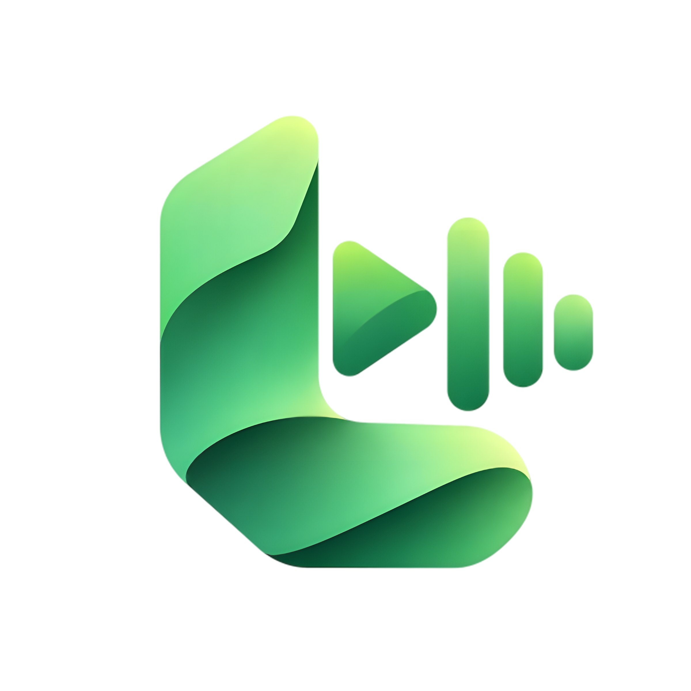
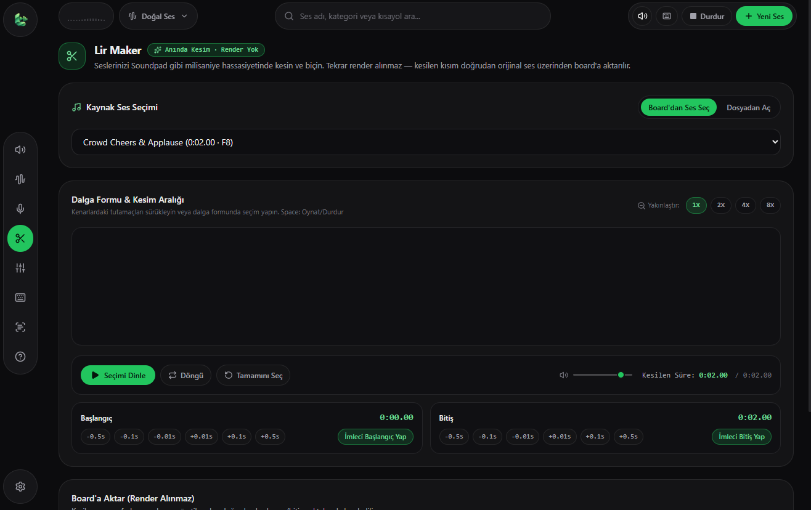
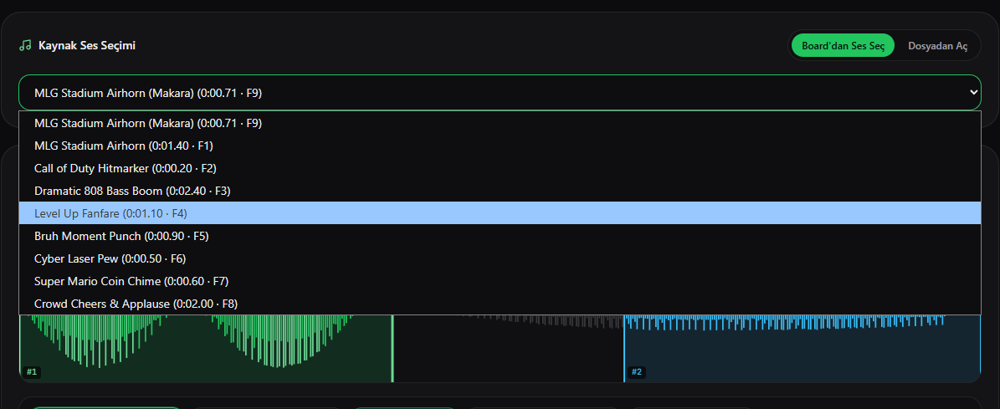

<div align="center">
  
  <h1>Lir</h1>
  <p><strong>Modern, açık kaynaklı Web ve Masaüstü Soundpad &amp; Ses Stüdyosu</strong></p>
  <p>
    Web Audio API, sanal kablo yönlendirme (VB-CABLE), tahribatsız ses kesme (Makara), gerçek zamanlı ses değiştirici, Spotify &amp; YouTube Müzik entegrasyonu ve global kısayollarla güçlendirilmiş Soundboard deneyimi.
  </p>

  <p>
    
    
    
    
    
  </p>
</div>

---

## Öne Çıkan Özellikler

- **Ses Tahtası (Soundboard):** Favoriler, kategori filtreleri, odaklanınca genişleyen hızlı arama çubuğu, kart bazlı ses seviyesi, döngü (loop), çalma modları (`overlap`, `restart`, `single`) ve canlı oynatma çubuğu.
- **Makara (Lir Maker):** Ses dosyalarını yeniden render almadan (*non-destructive*) milisaniye hassasiyetinde dalga formu üzerinden kesme, `1x`–`8x` yakınlaştırma ve çoklu kesit birleştirme.
- **Dış Kaynak (Spotify & YouTube Müzik):** Spotify OAuth ile beğenilen şarkıları ve çalma listelerini görüntüleme, YouTube / YouTube Music üzerinden ses arama, önbelleğe alma ve tek tıkla Soundboard'a veya doğrudan mikrofona aktarma.
- **Ses Kaydedici:** 60fps canlı frekans spektrumu, duraklat/devam et desteği, ses değiştirici efektleriyle veya ham kayıt alma ve kalıcı kayıt arşivi.
- **Gerçek Zamanlı Ses Değiştirici:** `AudioWorklet` tabanlı perde (pitch), yüksek/alçak geçiren filtre, bas ve netlik artırıcı, distorsiyon, ring modulation, yankı (echo), reverb ve hazır ses profilleri.
- **Altyazı Çevirisi (OCR):** `Tesseract.js` ile ekran metni okuma, Gemini API üzerinden anlık çeviri ve masaüstü sürümünde kayan şeffaf altyazı katmanı.
- **Ses Yönlendirme & VB-CABLE:** Sanal mikrofon girişi (`CABLE Input` / Voicemeeter) ve yerel monitör kulaklığı için eşzamanlı çift ses çıkışı + mikrofon pass-through.
- **Kısayol Matrisi & Akıllı Filtre:** Masaüstü genelinde (`globalShortcut`) kısayol tetikleme, yazı yazarken otomatik duraklatma ve uygulama bazlı izin listesi.
- **Uzaktan Kontrol (Remote Hub):** Yerel ağ veya WebSocket Relay Bridge üzerinden PIN korumalı mobil/web uzaktan kontrol.
- **Discord RPC & Koru Sinyalleri:** Masaüstü sürümde canlı Discord Rich Presence ve `signals.json` üzerinden otomatik sürüm/duyuru akışı.
- **Tema ve Arayüz Seçenekleri:** `AMOLED`, `Koyu`, `Açık` temalar; `Gama`, `Win11`, `Win10` pencere stilleri; özel vurgu renkleri ve `TR` / `EN` dil desteği.

---

## Ekran Görüntüleri

<table>
  <tr>
    <td align="center" width="50%">
      
      <br />
      <sub><strong>Makara (Lir Maker)</strong> — Milisaniye hassasiyetinde dalga formu kırpma</sub>
    </td>
    <td align="center" width="50%">
      
      <br />
      <sub><strong>Çoklu Kesit &amp; Önizleme</strong> — Tahribatsız kesit kuyruğu</sub>
    </td>
  </tr>
</table>

> **Not:** Diğer görünümlerden (`Ses Tahtası`, `Dış Kaynak`, `Ses Değiştirici`) yeni ekran görüntüleri aldığınızda `docs/screenshots/` altına ekleyip bu tabloyu genişletebilirsiniz.

---

## Teknoloji Yığını

| Katman | Kullanılan Teknolojiler |
| :--- | :--- |
| **Arayüz** | React 19, TypeScript, Tailwind CSS v4, Motion (`motion/react`), Lucide Icons |
| **Ses Motoru** | Web Audio API, özel `AudioWorklet` perde işlemcisi, `HTMLMediaElement.setSinkId` |
| **Sunucu & API** | Node.js, Express, `ws` (WebSocket Hub), Spotify OAuth, `youtubei.js`, `yt-search` |
| **Masaüstü** | Electron 44, `electron-builder` (Windows NSIS), `discord-rpc` |
| **OCR & Çeviri** | `tesseract.js`, `@google/genai` |

---

## Kurulum ve Çalıştırma

### Gereksinimler

- **Node.js** `20+` (önerilen `22+`)
- **npm** `10+`
- *(Masaüstü mikrofon yönlendirmesi için önerilir)* **VB-Audio Virtual Cable (VB-CABLE)**

### 1. Depoyu Klonlayın ve Bağımlılıkları Yükleyin

```bash
git clone https://github.com/SiberizmBey/Lir.git
cd Lir
npm install
```

### 2. Ortam Değişkenlerini Ayarlayın

`.env.example` dosyasını `.env` olarak kopyalayıp kullandığınız entegrasyonları doldurun:

```bash
cp .env.example .env
```

```env
PORT=3000
APP_URL=http://localhost:3000
SPOTIFY_CLIENT_ID=
SPOTIFY_CLIENT_SECRET=
YOUTUBE_API_KEY=
YOUTUBE_COOKIE=
```

> Spotify ve YouTube anahtarları opsiyoneldir; uygulama temel Soundboard, Makara, Ses Kaydedici ve Ses Değiştirici özellikleriyle ek anahtar olmadan doğrudan çalışır.

### 3. Geliştirme Ortamında Başlatın

**Web (Express + Vite):**

```bash
npm run dev
```

Uygulama varsayılan olarak `http://localhost:3000` adresinde açılır.

**Masaüstü (Electron):**

```bash
npm run electron:dev
```

---

## Derleme ve Paketleme

```bash
# Web üretim derlemesi
npm run build

# Üretim sunucusunu başlatma
npm start

# TypeScript tip kontrolü
npm run lint

# Windows masaüstü kurulum paketi (dist-electron/)
npm run electron:build
```

---

## Proje Yapısı

```text
Lir/
├── electron/               # Electron ana süreç, preload ve yerel API sunucusu
├── public/
│   ├── assets/img/         # Uygulama logosu ve simgeleri (lir.png, icon.png, icon.ico)
│   └── auth/callback/      # Spotify OAuth geri dönüş sayfası
├── server/                 # Spotify, YouTube, sistem uygulamaları ve Remote Hub API modülleri
├── src/
│   ├── components/         # Ses Tahtası, Makara, Dış Kaynak, Kaydedici, Ses Değiştirici, OCR, Ayarlar
│   ├── i18n/               # Türkçe (tr.json) ve İngilizce (en.json) çeviriler
│   ├── types/              # SoundItem ve ses yönlendirme tipleri
│   └── utils/              # AudioEngine, AudioWorklet, kısayollar, depolama ve API istemcileri
├── server.ts               # Express + Vite / üretim sunucu giriş noktası
└── package.json
```

---

<div align="center">
  <sub><strong>Lir</strong> — Antic Valley &amp; SiberizmBey tarafından geliştirilmektedir.</sub>
</div>
